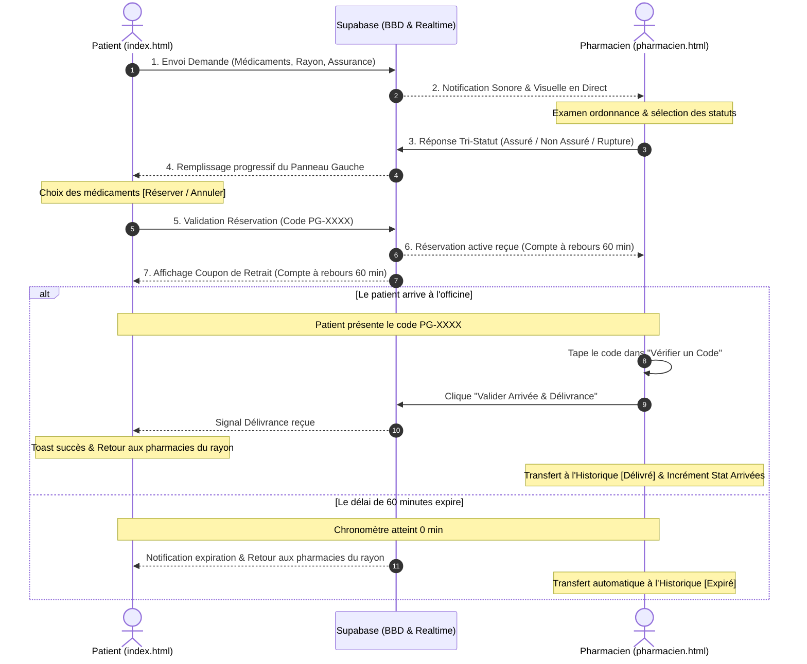

# 📖 DOCUMENTATION FONCTIONNELLE EXHAUSTIVE — PHARMA-GARDE v7.0
**Plateforme Intelligente d'Urgence Pharmaceutique & de Coordination Médicale**  
*Architecture Tripartite : Espace Patient · Espace Pharmacie · Espace Délégué Médical*

---

## 📑 TABLE DES MATIÈRES
1. [Vue d'Ensemble & Vision du Système](#1-vue-densemble--vision-du-système)
2. [Espace 1 : Patient / Client (index.html)](#2-espace-1--patient--client-indexhtml)
3. [Espace 2 : Pharmacie d'Officine (pharmacien.html)](#3-espace-2--pharmacie-dofficine-pharmacienhtml)
4. [Espace 3 : Délégué Médical (delegue.html)](#4-espace-3--délégué-médical-deleguehtml)
5. [Matrice des Interactions Croisées (Inter-Espaces)](#5-matrice-des-interactions-croisées-inter-espaces)
6. [Architecture des Données & Synchronisation Temps Réel (Supabase)](#6-architecture-des-données--synchronisation-temps-réel-supabase)
7. [Guides des Procédures Opérationnelles](#7-guides-des-procédures-opérationnelles)

---

## 1. VUE D'ENSEMBLE & VISION DU SYSTÈME

**Pharma-Garde** est une solution numérique de santé publique conçue pour résoudre le problème critique de l'accès aux médicaments en Afrique subsaharienne (particulièrement au Cameroun).  
Elle interconnecte en temps réel trois acteurs clés du circuit du médicament :

```
                        ┌───────────────────────────────┐
                        │      PATIENT / CLIENT         │
                        │    (Recherche, Ordonnance,    │
                        │     Réservation sous 60 min)  │
                        └───────────────┬───────────────┘
                                        │ ▲
              1. Demandes & Ordonnances │ │ 2. Réponses (En stock / Rupture)
                 & Réservations (60min) │ │    & Validation au comptoir
                                        ▼ │
┌───────────────────────────────┐       │       ┌───────────────────────────────┐
│       ESPACE PHARMACIE        │◄──────┴──────►│    DÉLÉGUÉ MÉDICAL (LABOS)    │
│  (Stock, Réponses, 60min,     │               │  (Promotions, Visites,        │
│   Alertes Ruptures, Stats)    │◄─────────────►│   Veille Ruptures de Stock)   │
└───────────────────────────────┘  3. Alertes   └───────────────────────────────┘
                                   & Visites & Promos
```

### Principes de Design & Charte Graphique
* **Or Étincelant (`#fbbf24` / `#f59e0b`)** : Prestige, clarté des statuts de garde et d'assurance, titres officiels et chronomètres de réservation.
* **Vert Émeraude (`#10b981` / `#059669`)** : Santé, disponibilité en stock, confirmation de délivrance et actions positives.
* **Blanc Pur (`#ffffff`)** : Typographie haute lisibilité sur fonds sombres (*Dark Glassmorphism*).
* **Rouge Corail (`#ef4444` / `#f87171`)** : Ruptures de stock, annulation de réservation et urgences.

---

## 2. ESPACE 1 : PATIENT / CLIENT (`index.html`)

Cet espace permet au patient ou à son proche de localiser instantanément les pharmacies de proximité, d'interroger les officines sur la disponibilité exacte de leurs médicaments, et de réserver leurs produits sous 60 minutes.

### 2.1. Géolocalisation & Rayon d'Action
* **Détection GPS automatique** : calcul de la position précise avec coordonnées latitude/longitude et précision en mètres.
* **Sélecteur de rayon dynamique dans l'en-tête** : pastilles `2 km`, `5 km`, `10 km`, `15 km`, `20 km`.
* **Carte interactive Leaflet** :
  * Pastilles vertes : pharmacies ouvertes de jour.
  * Pastilles ambrées avec icône lune : pharmacies de garde de nuit.
  * Masque sombre circulaire autour du rayon pour focaliser la vision du patient.
  * Boutons de zoom (`+`, `-`), recentrage rapide et bascule **Plein Écran**.
* **Badge de Ville** : identification automatique de la ville (ex: Douala, Yaoundé, Bafoussam...).

### 2.2. Recherche de Médicaments & Saisie d'Ordonnance
* **Saisie textuelle assistée** : auto-complétion intelligente connectée à une base de plus de 50 spécialités courantes camerounaises (`LOCAL_MEDICINES`).
* **Multi-médicaments par requête** : le patient peut ajouter autant de produits que nécessaire sur la même demande.
* **Prise en charge des Assurances Santé** :
  * Menu déroulant des principales mutuelles et assurances agréées : *CNPS, BEAC, Activa, Allianz, Area, Ascoma, AXA, Chanas, CPA, GMC, NSIA, Prudential, SAAR, Sunu, Zenithe, SABC...*
  * Option de saisie manuelle si l'assurance n'est pas dans la liste.
* **Scanner d'Ordonnance par OCR (Reconnaissance Optique)** :
  * Prise de vue directe via l'appareil photo du smartphone ou téléchargement depuis la galerie.
  * Reconnaissance de texte embarquée (moteur OCR Tesseract) filtrant automatiquement les termes médicaux pour pré-remplir la liste des médicaments.

### 2.3. Monétisation & Session Sécurisée (Mobile Money)
* Coût symbolique de **100 FCFA** pour une session de recherche de **24 heures illimitées**.
* Passerelle de paiement intégrée (NotchPay) prenant en charge :
  * **MTN Mobile Money** (MoMo).
  * **Orange Money**.
* Conservation du jeton de session dans le stockage local : aucune double facturation pendant 24h.

### 2.4. Multi-Demandes Simultanées (Sans Annulation)
* **Architecture multi-requêtes** : le patient peut lancer plusieurs demandes différentes en même temps (ex : une demande pour soi et une autre pour un parent).
* **Bandeau de suivi permanent** :
  * Affichage du compteur : `📋 X Demande(s) Active(s)`.
  * Bouton **`➕ Autre recherche / ordonnance`** : ouvre le modal de recherche pour une nouvelle demande sans interrompre les réponses en cours des précédentes.

### 2.5. Panneau de Réponses des Pharmacies en Direct
Dès que les officines du secteur reçoivent la demande, le panneau gauche du patient se peuple en temps réel :
* **Carte de la Pharmacie répondante** :
  * Nom de l'officine et distance exacte en kilomètres.
  * Adresse physique précise et repère.
  * Bouton d'appel téléphonique direct `📞 Appeler`.
  * Bouton WhatsApp pré-formaté `💬 WhatsApp`.
  * Bouton GPS `🗺️ Y aller` (traçage de l'itinéraire piéton/voiture sur la carte Leaflet).
* **Détail des Médicaments avec Tri-Statut** :
  * `✅ En stock assuré` : disponible et pris en charge par l'assurance spécifiée.
  * `⚠️ En stock non assuré` : disponible au comptoir mais hors convention d'assurance.
  * `❌ En rupture` : médicament indisponible dans cette officine.

### 2.6. Système de Réservation Réversible & Compte à Rebours 60 min
* **Bouton d'arbitrage par produit** :
  * Pour chaque médicament disponible, bouton vert **`Réserver`**.
  * Au clic, le bouton bascule instantanément en **`❌ Annuler`** *(rouge)* pour permettre au patient d'ajuster sa sélection.
* **Validation groupée** :
  * Bouton **`✅ Confirmer les réservations`** regroupant les produits sélectionnés (même auprès de plusieurs officines différentes).
  * Génération automatique d'un **Code de retrait sécurisé** (ex : `PG-8472`).
* **Coupon de Réservation Actif (60 minutes)** :
  * Compte à rebours dynamique : `⏱️ Expire dans 60 min` (avec mise en alerte rouge sous les 15 minutes).
  * Bouton **`➕ Faire une autre demande (sans annuler ces réservations)`** permettant de continuer à naviguer sans détruire le coupon.
* **Déclencheurs de Réinitialisation Automatique** :
  * **Au comptoir** : dès que le pharmacien valide le code `PG-XXXX`, le client reçoit la notification `🎉 Retrait validé ! Vos médicaments vous ont été remis`, et le panneau gauche réaffiche automatiquement les pharmacies ouvertes du rayon.
  * **À l'expiration** : dès que les 60 minutes sont écoulées, notification d'expiration et réinitialisation automatique vers les pharmacies du rayon.

---

## 3. ESPACE 2 : PHARMACIE D'OFFICINE (`pharmacien.html`)

Cet espace professionnel permet au pharmacien titulaire et à son équipe de gérer leur visibilité de garde, de répondre aux ordonnances, d'honorer les réservations au comptoir, de gérer les ruptures et de collaborer avec les délégués médicaux.

### 3.1. En-Tête Unifié Or & Émeraude (Barre de Tâche)
* **Bouton Retour Accueil** : bouton fléché renvoyant vers `index.html`.
* **Identité Visuelle** : logo à croix émeraude + marque **Pharma-Garde** surmontant la mention en or pur **`Espace Pharmacie`**.
* **Nom de l'Officine au Centre** : affiché en lettres d'or étincelantes (`#fbbf24`) avec relief lumineux.
* **Contrôles de Statut Intégrés** :
  * `🟢 Ouverte` : officine ouverte en journée normale.
  * `🌙 Garde` : officine assurant la garde de nuit ou de week-end (signalée en ambre aux patients).
  * `🔴 Fermée` : officine fermée au public.
* **Outils d'En-tête** : sélecteur de langue `FR | EN`, bouton `Plein Écran` et bouton d'accès rapide aux `Paramètres`.

### 3.2. Bouton Spécial 1 : Hub de Gestion de Stock & Alerte Rupture (2 Rôles)
Accessible en permanence sous la barre de tâche :
* **Rôle 1 : Inventaire & Interrogation de Base de Données** :
  * Tableau dynamique des produits avec statut actuel (`En stock` / `En rupture`).
  * Moteur de recherche instantané dans le stock de l'officine.
  * Bouton de bascule en un clic `Passer En Stock` ⇄ `Marquer Rupture`.
  * Bouton d'ajout rapide d'un nouveau médicament dans la base.
  * Bouton direct `📢 Alerter Délégués` en regard de chaque produit en rupture.
* **Rôle 2 : Diffusion d'Alerte Rupture vers les Délégués Médicaux** :
  * Formulaire dédié conforme aux besoins des officines :
    * *Nom du produit en rupture*.
    * *Niveau d'urgence* : Normale, Urgente, Critique.
    * *Rayon de diffusion* : 2 km, 5 km, 10 km, 15 km, 20 km.
    * *Message complémentaire* à l'attention des laboratoires.
  * **Architecture Zéro-Erreur RLS** : l'envoi s'effectue via insertion sécurisée et canal de broadcast en temps réel, garantissant qu'aucun message d'erreur rouge n'apparaît.

### 3.3. Bouton Spécial 2 : Vérification Universelle de Code (`PG` / `DM`)
Ouvre un modal de contrôle rapide à double usage :
* **Cas Code Client (`PG-XXXX`)** :
  * Isole exclusivement la demande et la réservation du patient.
  * Affiche le nom de l'assurance, la date/heure et la liste des médicaments réservés.
  * Bouton **`✅ Valider l'Arrivée du Patient & Délivrance`** :
    1. Valide la remise des médicaments.
    2. Clôture la réservation et la transfère immédiatement dans l'Historique avec mention `Délivré`.
    3. Incrémente le compteur officiel des patients arrivés en pharmacie.
    4. Envoie le signal en temps réel au client pour réinitialiser son écran.
* **Cas Matricule Délégué (`DM-XXXX`)** :
  * Isole exclusivement les fiches de visites et les promotions envoyées par ce délégué médical.

### 3.4. Panneau 1 : Demandes Patients Actives & Réservations (60 min)
* **Tableau structuré des demandes entrantes** :
  * Code de sécurité alloué au client (ex : `PG-8472`).
  * Nom de l'assurance santé (ou mention *Patient Direct*).
  * Date et heure précises de la requête.
  * Rayon kilométrique du patient.
* **Bloc des produits sollicités (3 boutons obligatoires par médicament)** :
  * `[✅ En stock et assuré]` *(vert émeraude)*.
  * `[⚠️ En stock non assuré]` *(or ambré)*.
  * `[❌ En rupture]` *(rouge corail)*.
* **Validation de la réponse** :
  * Modale de confirmation récapitulant les statuts choisis avant envoi immédiat.
* **Section des Réservations Actives (60 minutes)** :
  * Liste des réservations confirmées par les patients pour cette officine.
  * Compte à rebours dynamique en minutes restantes.
  * Bouton `✅ Valider Retrait` et bouton `❌ Annuler` (avec confirmation de sécurité).

### 3.5. Panneau 2 : Historique des Requêtes avec Filtres Temporels
* Quatre boutons de filtrage instantané :
  * `📅 Aujourd'hui`
  * `🗓️ Cette Semaine`
  * `📆 Ce Mois`
  * `📈 Cette Année`
* Tableau complet reprenant : Date/Heure, Code Client, Médicaments & Statuts, Résultat final (`Délivré`, `Rupture`, `Expiré`).

### 3.6. Panneau 3 : Espace Délégués Médicaux
Gestion des relations avec l'industrie pharmaceutique :
* **Sous-Section Promotions** :
  * Fiche détaillée par délégué : Nom, Prénom, Matricule officiel (`DM-XXXX`), Laboratoires partenaires.
  * Fiche produit, description thérapeutique et lien direct vers le document PDF promotionnel.
  * Boutons d'arbitrage : **`[✅ Intéressé]`** et **`[❌ Ignorée]`**.
* **Sous-Section Visites & Rendez-vous Médicaux** :
  * Date et heure proposées par le délégué médical.
  * Motif de la visite (présentation de gamme, audit...).
  * Trois boutons d'action :
    * `[✅ Confirmer]` : valide la visite.
    * `[🔄 Modifier Jour & Heure]` : ouvre la modale de replanification pour proposer une contre-proposition de date et d'heure renvoyée au délégué.
    * `[❌ Rejeter]` : décline la visite.

### 3.7. Panneau 4 : Statistiques (Les 4 Vues Métier)
* **Vue 1 : Total Demandes** :
  * Compteur du total des demandes reçues.
  * **Compteur des patients arrivés au comptoir** (incrémenté via la vérification de code).
  * **Top 10 des Médicaments les plus sollicités** avec comparateur temporel : *Jour, Semaine, Mois, Année*.
  * **Tableau des Médicaments recherchés hors stock** : produits fréquemment demandés par les patients de la zone mais en rupture dans l'officine, avec bouton d'alerte délégué en un clic.
* **Vue 2 : Acceptations** :
  * Total des demandes acceptées, total des promotions marquées intéressées, total des réservations achetées.
  * Indicateurs de conversion au comptoir.
* **Vue 3 : Promos** :
  * Tableau récapitulatif de toutes les offres commerciales regroupées par délégué et par laboratoire.
* **Vue 4 : Visites** :
  * Tableau de bord de toutes les visites sollicitées avec statuts (*Confirmée, Reportée, Annulée, En attente*).

---

## 4. ESPACE 3 : DÉLÉGUÉ MÉDICAL (`delegue.html`)

Cet espace permet aux délégués médicaux des laboratoires pharmaceutiques de cibler les pharmacies d'un secteur, de promouvoir de nouveaux produits, d'organiser leurs tournées et de répondre aux ruptures de stock.

### 4.1. Inscription & Accréditation Professionnelle
* Formulaire d'inscription rigoureux :
  * Nom, Prénom.
  * **Numéro de Carte Professionnelle** (ex : `DP-2023-4589`).
  * **Numéro de CNI**.
  * Email et Téléphone camerounais (+237).
  * Mot de passe avec indicateur de robustesse.
  * Attestation sur l'honneur d'habilitation par les laboratoires représentés.

### 4.2. Carte Géographique du Réseau Officinal
* Carte Leaflet interactive avec géolocalisation du délégué.
* Affichage de toutes les pharmacies du secteur avec filtres de rayon (2 à 20 km).
* Distinction visuelle des officines ouvertes et de garde.
* Fiche détaillée de chaque pharmacie au clic (adresse, titulaire, téléphone, WhatsApp).

### 4.3. Gestion des Promotions & Campagnes
* **Création d'une promotion** :
  * Nom de la molécule ou spécialité.
  * Laboratoire représenté (ex : *Sanofi, Novartis, Denk Pharma, Roche...*).
  * Type de produit : *Médicament, Complément, Matériel médical, Cosmétique*.
  * Description de l'offre commerciale et conditions de remise.
  * Pièce jointe (URL du document PDF d'argumentaire ou fiche posologique).
* **Ciblage géographique** :
  * Diffusion groupée à toutes les pharmacies dans un rayon donné ou sélection d'officines ciblées.
* **Suivi des retours en temps réel** :
  * Tableau de bord des réponses des pharmaciens : *Non lue, Lue, Intéressé, Déjà en stock, Ignorée*.

### 4.4. Organisation des Visites Médicales
* Prise de rendez-vous avec le pharmacien titulaire :
  * Choix de la pharmacie cible.
  * Date et heure souhaitées.
  * Motif de la visite (présentation de nouveauté, réassort, documentation).
* **Gestion des réponses de l'officine** :
  * Notification instantanée si le pharmacien confirme la visite.
  * Notification si le pharmacien propose une **nouvelle date et une nouvelle heure** (replanification).

### 4.5. Veille & Alertes Ruptures de Stock
* Réception en direct des alertes lancées par les pharmacies du secteur :
  * Nom de la molécule en pénurie.
  * Niveau d'urgence (Critique / Urgente / Normale).
  * Coordonnées et distance de l'officine demandeuse.
* Permet au délégué de contacter immédiatement la pharmacie pour proposer un réapprovisionnement prioritaire.

---

## 5. MATRICE DES INTERACTIONS CROISÉES (INTER-ESPACES)

### 5.1. Interaction Patient ⇄ Pharmacie


### 5.2. Interaction Pharmacie ⇄ Délégué Médical

```mermaid
sequenceDiagram
    autonumber
    actor Ph as Pharmacien (pharmacien.html)
    participant S as Supabase (BBD & Realtime)
    actor D as Délégué Médical (delegue.html)

    rect rgb(30, 45, 30)
    Note over Ph,D: Flux 1 : Alerte Rupture de Stock
    Ph->>S: Déclenche Alerte Rupture (Produit, Urgence, Rayon)
    S-->>D: Notification Sonore & Badge Alerte en Direct
    D->>Ph: Contact prioritaire pour approvisionnement
    end

    rect rgb(35, 35, 55)
    Note over Ph,D: Flux 2 : Promotion Commerciale
    D->>S: Crée Promotion (Labo, Produit, Remise, PDF)
    S-->>Ph: Apparition dans l'onglet Délégués > Promotions
    Ph->>S: Arbitrage [Intéressé] ou [Ignorée]
    S-->>D: Statut mis à jour sur le tableau de bord Délégué
    end

    rect rgb(50, 40, 25)
    Note over Ph,D: Flux 3 : Sollicitation de Visite Médicale
    D->>S: Demande de Visite (Date, Heure, Objet)
    S-->>Ph: Notification dans l'onglet Délégués > Visites
    alt Confirmation
        Ph->>S: Clique [Confirmer]
        S-->>D: Visite confirmée
    else Replanification (Contre-proposition)
        Ph->>S: Clique [Modifier Jour/Heure] (Nouvelle Date/Heure)
        S-->>D: Proposition de nouvelle date reçue
    else Rejet
        Ph->>S: Clique [Rejeter]
        S-->>D: Visite annulée
    end
    end
```


### 5.3. Interaction Tripartite Patient ⇄ Pharmacie ⇄ Délégué
* **Cas des Médicaments Introuvables / Rares** :
  1. Les patients recherchent un médicament rare qui n'est pas en stock dans les officines du secteur.
  2. Le système agrège ces requêtes dans l'espace pharmacie sous la table **`Médicaments Recherchés qui ne figurent pas dans votre stock`**.
  3. Le pharmacien clique sur **`Diffuser Alerte`** depuis cette table.
  4. Les délégués médicaux reçoivent l'alerte sur leur carte, identifient la demande locale et approvisionnent l'officine.
  5. Les futurs patients trouvant ce produit bénéficient d'un stock immédiatement reconstitué.

---

## 6. ARCHITECTURE DES DONNÉES & SYNCHRONISATION TEMPS RÉEL (SUPABASE)

### 6.1. Schéma des Tables Principales

| Table | Description | Clés Principales | Politiques RLS |
| :--- | :--- | :--- | :--- |
| **`requests`** | Demandes d'ordonnance émises par les patients | `id`, `session_id`, `medicines` (JSONB), `insurance_name`, `user_lat`, `user_lng`, `radius`, `status` | Lecture & insertion publiques |
| **`responses`** | Réponses officielles formulées par les officines | `id`, `request_id`, `pharmacy_id`, `medicines_status` (JSONB), `reservation_code`, `status`, `collected_at` | Lecture & insertion publiques |
| **`reservations`** | Réservations actives d'une durée de 60 minutes | `id`, `request_id`, `pharmacy_id`, `reservation_code`, `medicines_status` (JSONB), `status`, `expires_at`, `collected_at` | Lecture, insertion & mise à jour publiques |
| **`stock_alerts`** | Alertes de rupture diffusées vers les délégués | `id`, `pharmacy_id`, `product_name`, `urgency`, `radius`, `message`, `is_resolved` | Lecture & insertion publiques |
| **`pharmacy_stock`** | Inventaire local et statut des produits de l'officine | `id`, `pharmacy_id`, `product_name`, `in_stock`, `insured`, `category` | Lecture & écriture sécurisées |
| **`visit_requests`** | Rendez-vous sollicités entre délégués et pharmaciens | `id`, `delegate_id`, `pharmacy_id`, `proposed_date`, `purpose`, `status` | Synchronisation bidirectionnelle |
| **`promotion_targets`** | Ciblage et retours d'intérêt des promotions labos | `id`, `promotion_id`, `pharmacy_id`, `status` (sent/interested/ignored), `responded_at` | Synchronisation bidirectionnelle |
| **`pharmacies`** | Profils, coordonnées GPS et statuts d'ouverture des officines | `id`, `name`, `status` (open/guard/closed), `lat`, `lng`, `phone`, `license_number` | Profils officiels |
| **`delegates`** | Profils et accréditations des délégués médicaux | `id`, `first_name`, `last_name`, `pro_card`, `phone`, `email` | Profils officiels |

### 6.2. Publication Supabase Realtime
Toutes les tables critiques sont abonnées à la réplication `supabase_realtime` :
```sql
ALTER PUBLICATION supabase_realtime ADD TABLE requests;
ALTER PUBLICATION supabase_realtime ADD TABLE responses;
ALTER PUBLICATION supabase_realtime ADD TABLE reservations;
ALTER PUBLICATION supabase_realtime ADD TABLE stock_alerts;
ALTER PUBLICATION supabase_realtime ADD TABLE visit_requests;
ALTER PUBLICATION supabase_realtime ADD TABLE promotion_targets;
```

---

## 7. GUIDES DES PROCÉDURES OPÉRATIONNELLES

### 7.1. Procédure pour le Patient
1. Ouvrir l'application sur smartphone ou navigateur.
2. Cliquer sur **`Détecter ma position`** pour afficher les pharmacies du rayon.
3. Cliquer sur **`Médicaments`** ou **`Ordonnance`** (prise de photo OCR).
4. Sélectionner son assurance (ex: Ascoma) ou laisser *Sans assurance*.
5. Régler les 100 FCFA via MoMo / Orange Money pour activer la session de 24h.
6. Observer le remplissage progressif des pharmacies répondantes.
7. Sélectionner les produits disponibles via **`Réserver`** (modifiable avec **`❌ Annuler`**).
8. Cliquer sur **`✅ Confirmer les réservations`** : le code de retrait `PG-XXXX` s'affiche avec le compte à rebours de **60 minutes**.
9. Se rendre à la pharmacie (guidage par le bouton `🗺️ Y aller`).
10. Présenter le code au comptoir pour recevoir les médicaments.

### 7.2. Procédure pour le Pharmacien
1. Se connecter à son espace sur `pharmacien.html`.
2. Vérifier son statut d'ouverture dans l'en-tête (**`Ouverte`**, **`Garde`**, **`Fermée`**).
3. À la réception d'une notification sonore, ouvrir la demande patient dans l'onglet **`Demandes`**.
4. Cocher pour chaque médicament son statut : **`En stock et assuré`**, **`En stock non assuré`** ou **`En rupture`**.
5. Cliquer sur **`📤 Confirmer & Envoyer la Réponse au Patient`**.
6. Lorsque le patient arrive au comptoir avec son code `PG-XXXX` :
   * Cliquer sur le bouton **`🔍 Vérifier un Code`**.
   * Taper le code et cliquer sur **`✅ Valider l'Arrivée du Patient & Délivrance`**.
   * La commande est clôturée, transférée à l'historique et les statistiques sont incrémentées.
7. En cas de rupture critique sur un produit de l'inventaire :
   * Cliquer sur **`⚠️ Alerte Rupture & Gestion Stock`**.
   * Remplir le nom du produit, l'urgence et le rayon, puis cliquer sur **`Envoyer l'alerte`** pour mobiliser les délégués médicaux du secteur.

### 7.3. Procédure pour le Délégué Médical
1. Se connecter sur `delegue.html` avec ses identifiants professionnels.
2. Consulter la carte pour visualiser les pharmacies actives du secteur.
3. Lancer une campagne via le bouton **`+ Nouvelle Promotion`** en joignant le document d'information médicale.
4. Solliciter une visite auprès du pharmacien titulaire en choisissant le jour et l'heure.
5. Surveiller l'onglet **`Alertes`** pour intervenir dès qu'une officine signale une rupture sur ses molécules partenaires.

---
*Pharma-Garde v7.0 — Document Technique & Fonctionnel Certifié Conforme.*
